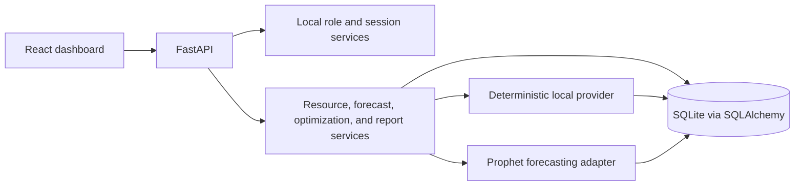

# Automated FinOps architecture

## Scope

Automated FinOps is a local academic demonstration. Resource records, telemetry,
forecasts, savings estimates, and optimization actions are simulated. The application
does not call AWS or another cloud provider and needs no cloud credentials or paid
service.

## Components

- `frontend/`: React, Vite, TypeScript, Tailwind CSS, React Router, Chart.js, and
  Lucide React. The browser calls the local FastAPI service.
- `backend/app/`: FastAPI routes, SQLAlchemy models, business services, simulator,
  forecasting, and optimization modules.
- `backend/app/providers/`: a local provider interface and simulator implementation.
  It defines an extension seam for future providers; no real provider is implemented.
- `backend/data/`: runtime SQLite database location, excluded from version control.
- `docs/`: architecture, requirements, and user documentation.

## Data flow

The simulator seeds repeatable resources and historical metrics into SQLite. API
services read persisted data and provide dashboard summaries, forecasts, and
recommendations. Protected optimization actions require authorization and approval;
executions only alter simulated records and produce audit events.

## Persistence and boundaries

SQLite is initialized locally through SQLAlchemy metadata/schema initialization.
Models keep users, resources, metric observations, forecasts, recommendations,
actions, policies, audit events, and settings separate. Money is represented in
integer minor units. Runtime database files, secrets, virtual environments, and
build output are not source artifacts.

The provider interface isolates telemetry collection from business services. Any
future real provider integration would require a separate, explicit implementation
and must preserve the simulated-data labeling in this project's demo mode.

## Implementation sequence

1. Establish the architecture and requirements.
2. Build database models and deterministic synthetic telemetry.
3. Add resource, authentication, and summary APIs.
4. Add persisted Prophet forecasting and forecast APIs.
5. Add transparent optimization recommendations and guardrails.
6. Add approval, simulated execution, policies, and audit logging.
7. Build and connect the dashboard.
8. Add reports, CSV export, validation, and error handling.
9. Run and repair automated workflow tests.
10. Complete setup and user documentation.
